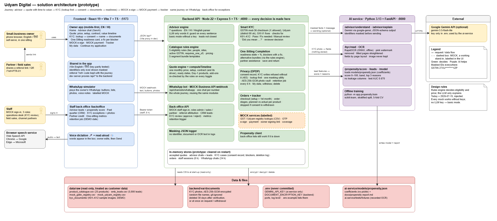

# Architecture diagram



| File | Use |
|---|---|
| `architecture.png` | Transparent background, for slides (2240 × 1000). |
| `architecture.svg` | Transparent background, scales without blurring. |

All three come from one description in [`scripts/architecture_diagram.py`](../../scripts/architecture_diagram.py),
so they always match. After changing the script, regenerate them (PowerShell, repo root):

```powershell
python scripts/architecture_diagram.py
$svg = (Resolve-Path docs\architecture\architecture.svg).Path -replace '\\','/'
& "C:\Program Files\Google\Chrome\Application\chrome.exe" --headless=new --disable-gpu --hide-scrollbars `
  --default-background-color=00000000 --window-size=2240,1000 `
  --screenshot="$((Resolve-Path docs\architecture).Path)\architecture.png" "file:///$svg"
```

What the diagram shows:
- **People**: the owner (phone, English / Hindi), partners and field sales (referral link),
  staff (operations desk, sales, partners; MOCK sign-in), and the browser's speech service.
- **Frontend** (React, port 5173): owner app, WhatsApp simulator, staff back-office, voice.
- **Backend** (Express, port 4000): every decision: rules engine, quote + `computeTimeline`,
  advisor engine, WhatsApp bot, Smart KYC, One-Sitting Completion, privacy, orders, back-office,
  MOCK services, masking logger, in-memory stores.
- **AI service** (FastAPI, port 8000): advisor wording via Gemini (optional), OCR, propensity
  scoring, offline training. Called only by the backend.
- **Data & files**: `data/raw` (read-only), the encrypted photo folder, `.env`, the model file.
